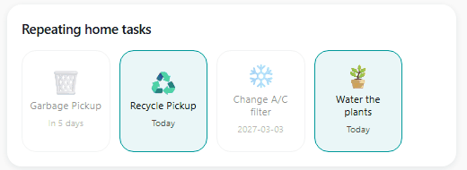
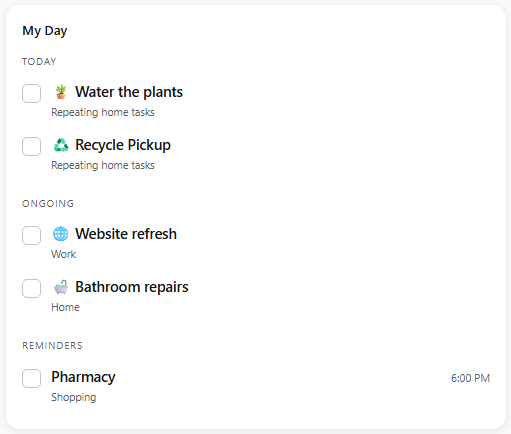
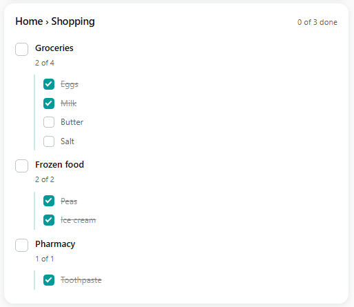

# ProgressCove for Home Assistant

Home Assistant integration for [ProgressCove](https://progresscove.com), a task management platform
with web, iOS and Android clients. While the integration is MIT licensed and open, access to read
and write data requires an active subscription. Fully functional 14 day trial is available to test
features, no card required.

Easiest install is via [HACS](https://hacs.xyz), see [Installation](#installation).

Integration adds the following to Home Assistant:
- To-do list entities for any part of the to-do tree, which show up as a standard to-do list, usable
  by the built-in card, integrations, voice assistants and ProgressCove's own list card.
- Tasks as buttons or switches, usable in integrations, and best for ProgressCove's own repeating tasks card.
- Progress sensors, so project states can be tracked as a numeric value.
- New Dashboard cards:
  - My Day: Similar to the widget on mobile apps, shows due and ongoing tasks and reminders for the day.
  - Project card: Shows list view of any selected point in the task tree two descendants deep.
  - Icon card: This will show selected tasks as buttons that are clickable when due.
  - Add task card: A text field that adds a task to the inbox or any picked list.



A tile is lit and active when due and dimmed and inactive when not, aimed at tracking repeating
chores.



My Day shows the day's due tasks, ongoing tasks and any reminders set for the day.



Project card shows a tree view of any project, its tasks and subtasks and is interactive.
Alternative to Home Assistant's built-in to-do card, which flattens the view.

## Status

The integration is stable, in daily use and available in the HACS default store.

Please post bugs and feature requests on
[GitHub Issues](https://github.com/Twenty-Shores/progresscove-homeassistant/issues).

## Requirements

- Home Assistant 2026.3 or newer.
- Active ProgressCove subscription. Fully functional 14 day trial is available to test features, no card required.

Additional technical details are below, generated from the source code.

## Installation

Easiest install is via [HACS](https://hacs.xyz):

[](https://my.home-assistant.io/redirect/hacs_repository/?owner=Twenty-Shores&repository=progresscove-homeassistant&category=integration)

1. Install **ProgressCove** in HACS, with the button above or by searching for it.
2. Restart Home Assistant, then follow the Setup steps below.

## Setup

You need an API token from ProgressCove. The web app is the easier place to make one, since the
token is shown only once and the pairing code is a copy/paste.

1. In ProgressCove, go to **Settings → Advanced → API Tokens** and create a token. Copy it now;
   you will not see it again.
2. In Home Assistant, go to **Settings → Devices & Services → Add Integration → ProgressCove**.
3. Paste the token and leave the server address alone.
4. Home Assistant shows a pairing code. Type it back into ProgressCove to activate the token.
   Until you do, the token opens nothing.
5. Pick your lists (see below).

The server address is prefilled because there is no self-hostable ProgressCove server today. The
field exists for developing against a local backend, and so the integration does not assume there
never will be one.

You can point it at a plain `http://` address, and it will ask you to confirm first. Your token and
your task names cross the network in the clear over http. On a LAN you control that is your call;
over the internet it is not something you want.

## What counts as a list

**Whatever you say is.** Not a tier, not a "project", and not only the nodes that happen to have
subtasks today. Any node in your tree can be a list.

That matters because a list is wherever *you* keep the checkable things, and that differs by branch:

```
Home                          ← a list (its projects are the items)
└── Shopping                  ← a list (its sections are the items)
    ├── Groceries             ← a list (its items are the items)  ← usually what you want
    │   ├── Milk
    │   └── Bread
    └── Frozen food           ← a list
```

Both `Shopping` and `Groceries` are real lists in the same account, at different depths. A rule like
"projects are lists" would put `Groceries` on a card as a single line to tick and leave the milk
unreachable.

So pick the level you actually shop from. For most shopping lists that is the store section, not the
trip.

**The picker offers every node, and pre-ticks the ones that already hold items.** A task with no
subtasks yet is still on the list. Pick it and you get an empty list that fills itself the moment
you add the first subtask, no return trip to this screen. What is pre-ticked is a starting point,
not a rule: tick a task you are about to break down, untick a branch you never want on the wall.

Each list you pick becomes its own entry under the account on the integration page, the same way a
button or a switch does. Two buttons at the top of the integration page change them:

- **Manage lists** opens the same picker with your current lists ticked. Tick a row to add that
  list, untick one to remove it, several at once if you like.
- **Add a list** picks one node and adds it, the same way **Add a button** does.

Either way the list gets the same kind of row. To remove a single list, open the menu on its own row
and delete it, or untick it under **Manage lists**. Removing a list removes its entity and touches
nothing in your data.

## What you get

| Entity | What it is |
|---|---|
| `todo.progresscove_<list_path>` | One per list you picked, each its own entry on the integration page. Its direct children are the items. |
| `todo.progresscove_my_day` | Today, decided by the server: the same "today" your phone shows. Always present. |
| `todo.progresscove_inbox` | Your inbox, for adding without choosing a list first. Always present. |
| `button.progresscove_<task>` | A task you added as a wall button. Press to complete today's occurrence. |
| `switch.progresscove_<task>` | A task as a switch: readable in automations, off to complete. |
| `sensor.progresscove_<project>` | How far through its items a project is, as a percentage. |

Buttons, switches and sensors are added one at a time from the integration card, never
automatically. One per task would be hundreds of entities nobody asked for.

Every entity sits under one **ProgressCove** service device per account, which is why each entity
id starts with `progresscove_`. The device and the entities are tied to the account rather than to
this particular setup, so removing the integration and adding the same account again brings back
the same entities. An account can be set up once per Home Assistant; adding it a second time is
refused.

### Button or switch?

Both complete a task. Pick by what you want back from it.

A **button** is a press with no state. Use it for a recurring job on a wall tablet, where the only
question is "done", and there is nothing to read afterwards. A button never claims to be reversible,
which suits a repeat.

A **switch** is readable as well as pressable, so use it when something needs to ASK whether a task
is done: a template, a condition, or a trigger on `to: "off"`. The cost is that a repeat's switch
does not stay off, since completing one reopens it on a later day.

Add either from the integration page; a task can have both.

### When a task is deleted

A task deleted in the app leaves its list, button, switch or sensor here with nothing to point at.
Before anything is touched, the integration asks the server about that one task. Only a clear "it is
gone" counts, never a task list that merely came back without it. It asks about a few tasks per
update, so after deleting a whole project the repair fills in over a few minutes rather than all at
once.

Then a **Some entities point at deleted tasks** repair appears under **Settings → System →
Repairs**, naming them. Open it and confirm to remove them in one step. It asks first because
removing an entity also takes it out of any automation or dashboard that uses it. To have them
removed without asking, turn on *Remove entities when their task is deleted* in the integration's
options.

### Automations

A task **switch** is on while the task is open and off once it is done, so "when I finish the bins"
is a state trigger to `off`. For "when this project is finished", trigger on the list's own
`items_complete` attribute, which is a boolean and needs no threshold. A progress **sensor** is for
the other question: it reports percent as a recorded measurement, so progress can go on a graph or a
gauge.

Triggers only see a list's own items. To act on something deeper, such as a task inside a section,
either add that section as its own list, or call `progresscove.complete` with the task's `node_id`,
which works at any depth and is the only way to reach a subtask.

### Subtasks

A to-do item has no room for children, and the Home Assistant frontend cannot nest them. Rather than
flatten subtasks in beside their parents as though they were peers, they are read with
`progresscove.get_nested_items` (see below). Their counts stay on the entity as `nested_items_done`
and `nested_items_total`, so an automation can ask "how much is left underneath" without a call.

## Completing things

**A repeating task gives you ten seconds to change your mind.** Ticking one marks it done straight
away and tells the server only once the window closes. Tap again inside it and nothing was ever
sent. Touchscreens get mistapped, and the task next to the one you meant is one finger-width away.

Only repeats wait. Completing a repeat rolls it to its next occurrence and nothing puts that back,
so the window is the one chance to undo it. An ordinary task is sent immediately, since it reopens
perfectly well afterwards.

If the integration reloads inside the window, for example because you changed your lists or fixed a
repair, a repeat you ticked is sent at once rather than lost. If it cannot be sent, a notification
says so. A restart of Home Assistant inside the window sends it too. Notifications do not survive a
restart, so a failure then is written to the Home Assistant log as an error instead.

**A task that is not due yet is refused.** Completing an occurrence before it arrives moves a repeat
past the one you were waiting for, so the button and the switch both say no and tell you the date it
is next due. If you would rather decide that for yourself, turn on *Allow completing before the due
date* in the integration's options.

A repeat's switch does not stay off. Once the ten seconds pass it rolls to its next occurrence and
the switch returns to `on`, because the task is open again, just on a later day. A trigger on `to:
"off"` still fires; a condition like "only while the bins are off" will not hold, because off lasts
about ten seconds. The switch also stays `on` on days the task is not due: it reports whether the
task is open, not whether today is its day. For that, read its `due_date` attribute, or use a
button, whose icon-card tile dims until the next occasion it is due.

## Cards

Four cards ship with the integration. Setting it up adds them to your dashboard resources once, so
they are in the card picker straight away, with nothing to copy and nothing to add by hand: search
for "ProgressCove" under **Edit → Add card**, or paste one of these under **Edit → Add card →
Manual**.

The integration remembers which resources it added. If you delete one under **Settings →
Dashboards → Resources**, it stays deleted: it is not added back on the next restart or upgrade.
Removing the last ProgressCove account removes the resources the integration added and nothing
else. If your resources are kept in YAML, nothing is written to them; the cards are loaded alongside
the frontend instead, until the last account is removed.

Their urls carry a digest of the card files, so an upgrade that changes a card moves the resource
the integration added to the new url, and the copy your browser is holding is retired on its own.

### My Day


```yaml
type: custom:progresscove-myday-card
title: My Day
```

Reads `todo.progresscove_my_day` and renders the server's three sections, with the parent name
under each task so a nested one is not stranded without context. Tapping ticks it off; the integration holds the write
for ten seconds, so tapping again inside that window undoes it.

### Icons


```yaml
type: custom:progresscove-icon-card
title: Recurring chores
columns: 3
entities:
  - button.progresscove_water_the_plants
  - button.progresscove_take_garbage_out
```

One tile per task, drawn as its emoji. A tile is lit and pressable only on the day it is due; every
other tile is dimmed and shows when it is next due.

### Projects


```yaml
type: custom:progresscove-card
entities:
  - todo.progresscove_home_shopping_groceries
```

Or `demo: true` to preview with sample data.

### Add a task

```yaml
type: custom:progresscove-add-card
entity: todo.progresscove_inbox
```

A text field and an **Add** button; Enter adds too. The text goes to `todo.add_item` on the chosen
list, `todo.progresscove_inbox` unless another is picked, and becomes the new task's name as typed.
The field clears after an add and the card says which list it went to. A refused add keeps the text in the field and shows the reason. With a
read-only token the field is off and the card says adding is not allowed.

### Switches in stock cards

A task switch works in Entities, Tile or Button cards as an ordinary toggle. Turning one off
completes the task. On a repeat that happens once the ten-second window closes, and turning it back
on inside the window undoes it.

The stock **To-do list** card works on any of these entities too; it just shows one flat list with
no sections or nested items.

## Refresh interval

The integration checks every minute, so a change made in the app, on the web, or on your phone shows
up within a minute.

That interval governs **inbound** changes only. Anything you do *from* Home Assistant is sent
immediately and never waits for it.

## Reading a list's items

Items come from **`todo.get_items`**, the same service every to-do integration uses, so anything
that can read a stock list can read ours at any size:

```yaml
action: todo.get_items
target:
  entity_id: todo.progresscove_home_shopping_groceries
```

A picked list's items are deliberately NOT entity attributes. Home Assistant writes an entity's
attributes into its state on every change and sends them to every browser connected to it, whether
or not that browser shows the list, and the recorder refuses attributes over 16 KB: it logs a
warning and stores none of them, so a long list would lose its counts from history too. What stays
on the attributes are the counts (`items_done`, `items_total`, `items_percent`, `items_complete`,
`nested_items_total`, `nested_items_done`): fixed-size, and what an automation actually asks for.
`progress_bar_hidden` sits beside them: whether the list's progress bar is turned off in the app,
which the projects card follows.

Subtasks are one level below what `get_items` returns, since a to-do item has no children. For
those, **`progresscove.get_nested_items`** takes a `node_id` and returns them keyed by their parent:

```yaml
action: progresscove.get_nested_items
data:
  node_id: "{{ state_attr('todo.progresscove_home_shopping', 'node_id') }}"
```

Because a picked list's attributes are counts only, recording its history costs about 230 bytes
per change whatever its size. If you want even that gone, exclude the entity under `recorder:`; the
cards read live state and never history.

My Day follows the same rule. `todo.get_items` on `todo.progresscove_my_day` returns today's items
in the server's order. What a to-do item has no field for, each item's section, the path to it, its
emoji and the time it is for, comes from **`progresscove.get_my_day_details`**, which the My Day
card calls:

```yaml
action: progresscove.get_my_day_details
target:
  entity_id: todo.progresscove_my_day
```

## Scopes

A token is **read-only** or **read and write**, chosen when you create it. A read-only token can
show your tasks and complete nothing, which suits a dashboard you do not want to tap by accident.
The choice is fixed for the life of the token; to change it, create a new one.

With a read-only token the integration says so when you set it up, then carries on with what the
token can do. Lists, My Day and the cards show your tasks. Ticking, adding and deleting are off,
there are no button or switch entities, the services refuse with a read-only message, and the
cards draw rows you cannot tap. A **ProgressCove is read-only** repair stays on the integration
page until the token can write.

To turn the controls on, create a read and write token in ProgressCove, open the integration,
choose **Reconfigure** from its menu and paste the new token there. Like the first one it needs
pairing, and it has to belong to the same account. The integration reloads with the controls
back.

A token can be revoked whenever you like, from the same **API Tokens** screen that created it.
Revoking cuts off that Home Assistant instance immediately and touches nothing else, so a lost or
retired box is one tap rather than a password change.

## If your subscription lapses

ProgressCove stops sending your tasks, so the integration's entities become unavailable and a
**ProgressCove subscription is not active** repair says why. Your token is still fine, so you are
not asked for a new one. Renew in the app under **Settings → Sunrise** and Home Assistant reconnects
on its own within a few minutes; the repair goes away with it.

## License

MIT. See [LICENSE](LICENSE).
